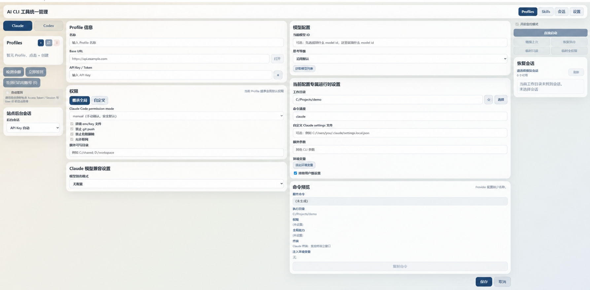
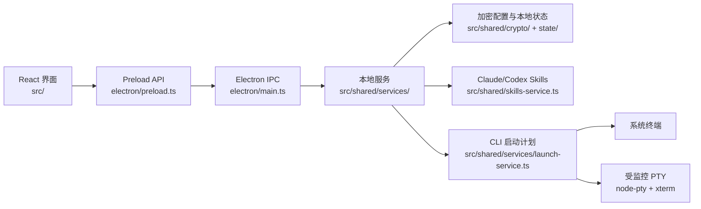

# CodeDeck

<p align="center">
  
</p>

<p align="center">
  <strong>管理 Claude Code 和 Codex 的多套配置、权限和运行环境，全部放在一个本地桌面应用里。</strong>
</p>

<p align="center">
  同时用多组账号、多个模型网关、不同工作目录？<br />
  CodeDeck 把 Profile、Skills、权限、历史会话和终端运行状态放到一处管理，<br />
  启动前还能最终确认命令和环境变量。
</p>

<p align="center">
  <a href="https://github.com/tmdy/CodeDeck/actions/workflows/ci.yml"></a>
  <a href="LICENSE"></a>
  <a href="https://github.com/tmdy/CodeDeck/releases"></a>
</p>

<p align="center">
  <a href="#快速开始">快速开始</a> ·
  <a href="#功能亮点">功能亮点</a> ·
  <a href="#架构">架构</a> ·
  <a href="https://github.com/tmdy/CodeDeck/releases">下载</a> ·
  <a href="CONTRIBUTING.md">参与贡献</a>
</p>



*上图为 Windows 上实际运行的 Profiles 管理页面，公开版本已将个人工作目录替换为示例路径。*

---

## 功能亮点

### Profile 管理，带启动预览

每个站点 Profile 保存 Base URL、API Key/Token、模型、工作目录、额外参数和环境变量。Provider 列顶部还提供一个"官方 CLI Profile"，不要求填写站点凭据或模型配置即可直接使用本机 Claude / Codex 全局配置。

启动前检查最终命令和环境变量摘要，确认无误再真正执行。

*代码：`src/shared/profile/` · 测试：`src/shared/__tests__/services/launch-service.test.ts`*

### Claude 与 Codex 两套权限模型，分开管理

Claude Code 使用 `--permission-mode` 和 managed settings；Codex 使用 `sandbox_mode`、`approval_policy` 与 managed rules。两套配置分别保存，也可在单次启动时临时覆盖。

*代码：`src/shared/profile/permissions.ts` · 测试：`src/shared/__tests__/profile/permissions.test.ts`*

### Codex 隔离运行时

Codex Profile 使用 CodeDeck 管理的 `CODEX_HOME`，不会直接改写用户全局 `.codex` 配置。全局 MCP、Skills 和已启用的插件可在需要时通过 runtime overlay 接入。系统终端直接启动的 Codex 不受影响。

*代码：`src/shared/services/capability-overlay-service.ts` · 测试：`src/shared/__tests__/services/capability-overlay-service.test.ts`*

### 受监控终端

Claude Code 和 Codex 都可在一个 PTY 终端中启动，支持复制、粘贴、窗口标题同步和运行状态跟踪。Codex 终端还可以按失败关键字自动发送"继续"（auto-continue），并在运行中调整次数、间隔或暂停。

*代码：`src/shared/electron/terminal-session-manager.ts` + `terminal-auto-continue.ts` · 测试：`src/shared/__tests__/electron/`*

### 本地 AI 委托

启用“本地 AI 委托接口”后，`codedeck-agent` 可列出允许的 Profile，并在独立受监控终端中异步运行任务。`run` 支持 `--model`、`--reasoning-effort`、`--show-terminal` 与 `--return-policy once|continuous|manual`；从 CodeDeck 监控终端发起时，子任务回答可在父终端空闲后自动作为下一轮输入。关闭可见子终端窗口仍会明确停止该子任务。

```powershell
"审阅当前改动" | codedeck-agent run --profile "codex::Review" --model "gpt-5.6" --reasoning-effort high --return-policy once --wait-ms 0
codedeck-agent status --session "<session-id>"
codedeck-agent interrupt --session "<session-id>"
```

受委托子进程不能递归启动其他任务；它只获得读取或修改自身回传策略、以及用 ESC 中断绑定父会话当前轮次的作用域能力，例如 `codedeck-agent policy --return-policy manual` 和 `codedeck-agent interrupt-parent`。父会话可用 `codedeck-agent interrupt --session "<session-id>"` 中断自己的子任务；中断不会关闭任一终端。

### Skills 可视化管理

扫描 Claude / Codex 的 Skills 目录，区分 `active`、`inactive`、`conflict`、`readonly` 四种状态。启用、停用和项目复制先生成操作预览再执行；执行记录支持回滚最近一次成功批次。

*代码：`src/shared/skills-service.ts` · 测试：`src/shared/skills-service.test.ts`*

### 会话恢复与收藏

读取 Claude 与 Codex 的本地历史。Codex 会话可以同时来自 App Runtime 和用户全局 `.codex`，恢复前会按需导入隔离运行时。常用会话可以跨 Provider 收藏。

*代码：`src/shared/services/session-service.ts` · 测试见 `src/shared/__tests__/services/session-service.test.ts`*

### 本地加密存储

Profile 凭据、运行时环境变量和全局代理保存在本地加密文件中（PBKDF2-HMAC-SHA256 派生密钥，Fernet 兼容格式）。首次打开时可选择用户输入口令（输入两次确认），或使用 Windows 账户保护的随机密钥免口令自动解锁。加密文件在进入主界面**前**立即落盘。

> 用户口令丢失后无法恢复数据；免口令密钥不能保证在其他系统账户或重装后恢复。
> 主题、工作目录、会话摘要和日志等运行状态不在口令保护范围内。

*代码：`src/shared/crypto/` · 测试：`src/shared/__tests__/crypto/store.test.ts`、`fernet.test.ts`*

所有功能的完整代码与测试索引见 [docs/features.md](docs/features.md)。

---

## 快速开始

Windows 10/11 x64 用户可从 [GitHub Releases](https://github.com/tmdy/CodeDeck/releases) 下载安装包。以下是从源码启动的方式。

### 环境要求

- Windows 10/11 x64
- Node.js >= 22.12
- npm
- 要真正启动 CLI，还需安装对应 CLI 并确保 `claude`、`codex` 在 `PATH` 中

### 从源码启动

```powershell
git clone https://github.com/tmdy/CodeDeck.git
cd CodeDeck
npm ci
npm run dev
```

Vite 开发服务器固定使用 `5173` 端口，端口被占用时脚本会直接退出。应用启动后先要求创建或输入本地加密口令，随后进入 Profiles 页面。

如果 `node-pty` 与当前 Electron ABI 不匹配，运行：

```powershell
npm run rebuild:native
```

首次使用详细说明见 [入门指南](docs/getting-started.md)。常见问题见 [FAQ](docs/troubleshooting.md)。

### 一个常见用法

1. 在 Profiles 页面选择 Claude Code 或 Codex。
2. 新建 Profile，填写站点地址、凭据、模型和工作目录。
3. 选择系统直连或受监控终端，并检查命令预览。
4. 启动 CLI。之后可在 Sessions 页面恢复本地历史会话。

Skills 是另一条独立流程：扫描本机 Skills，选择项目或全局范围，查看操作预览，再决定是否执行。

---

## 架构

应用本身没有配套后端 — "本地应用"不等于"完全离线"。余额、签到、模型列表和 CLI 请求仍会访问用户配置的外部站点。



---

## 本地数据

开发模式默认把运行数据放在仓库 `app-data/`，打包版本默认使用 Electron `userData` 下的 workspace。可通过 `CodeDeck.project-root.txt` 或 `CODEDECK_PROJECT_ROOT` 环境变量选择其他工作区。

**不要提交到 Git 的内容：**

| 目录 | 原因 |
|---|---|
| `app-data/` | 运行配置、日志和备份 |
| `library/` | 个人 Skills 集合 |
| `dist/`、`dist-electron/`、`release/` | 构建产物 |

正式安装包不内置开发机器上的 `library/`，安装后可通过 Skills 页面导入。

详细配置说明见 [配置与本地数据](docs/configuration.md)。

---

## 开发与验证

```powershell
npm run typecheck
npm test
npm run build
npm run dist:win        # 生成 Windows NSIS 安装包
```

其他常用命令：

| 命令 | 用途 |
|---|---|
| `npm run dev` | 启动完整 Electron 开发环境 |
| `npm run dev:renderer` | 只启动 Vite Renderer（端口 5173） |
| `npm run test:watch` | 持续运行测试 |
| `npm run rebuild:native` | 为当前 Electron ABI 重建 `node-pty` |

`npm run preview` 只预览 Vite Renderer，不是完整的 CodeDeck — 主界面依赖 Electron preload API。

完整的开发指南见 [docs/development.md](docs/development.md)。

---

## 文档

- [入门指南](docs/getting-started.md)
- [功能证据（代码与测试索引）](docs/features.md)
- [配置与本地数据](docs/configuration.md)
- [开发与打包](docs/development.md)
- [常见问题](docs/troubleshooting.md)
- [权限模型](docs/specs/permissions.md)
- [V1 设计背景](docs/specs/2026-05-02-codedeck-v1.md)

---

## 参与贡献

提交修改前请阅读 [CONTRIBUTING.md](CONTRIBUTING.md)。安全相关问题请按 [SECURITY.md](SECURITY.md) 中的方式报告，不要在公开 Issue 中粘贴凭据或完整运行日志。

## 友情链接

- [LinuxDo](https://linux.do) — 开发者交流社区。

## License

源码使用 [MIT License](LICENSE)。Windows 安装器展示的 [LICENSE.txt](LICENSE.txt) 是中文说明文本，不替代仓库根目录的 MIT License。