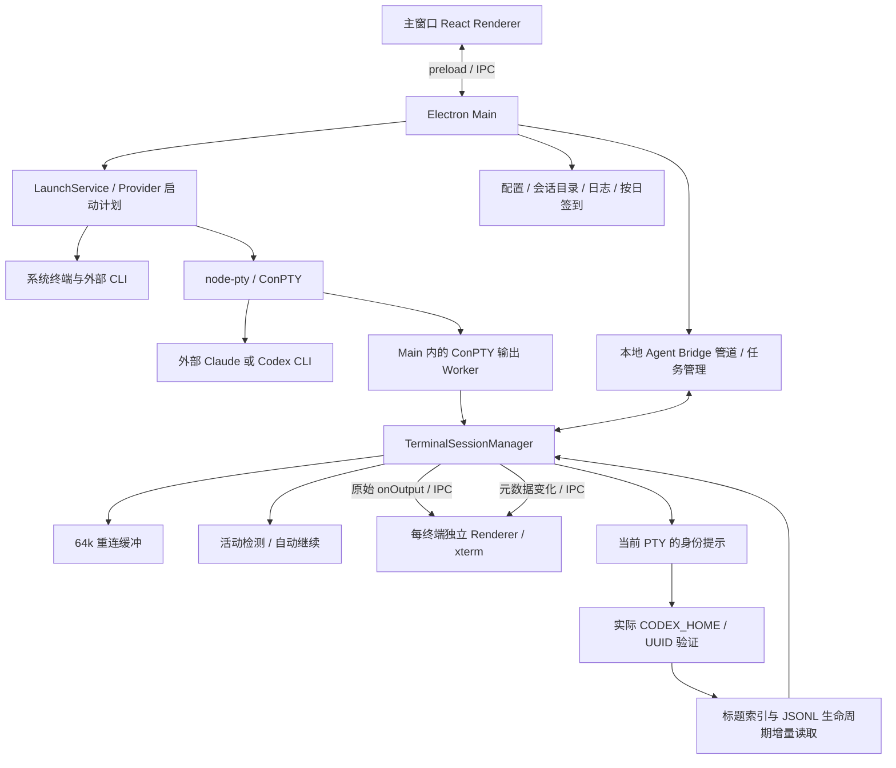

# CodeDeck 性能审计与第一批资源优化

本轮完成第一阶段审计、可复用基线和四个产品文件的增量修复。主要收益是消除已关闭终端的 JS 保留、减少完整历史的复制与 IPC 推送；空闲时整个 Electron 应用的固定占用没有明显下降。活动回合的文本解析、ConPTY 原生管道、长期 Bridge/Renderer 缓存仍需后续处理。

## 1. 基线、范围和证据

- 日期：2026-10-11，Windows 11 26200，i5-13600KF，14 核 / 20 逻辑处理器，约 31.8 GiB 系统可见物理内存。Electron 39；模块基准使用 Node 22.23.1。
- 源码基线：HEAD `8ec9190` 加任务开始时已有的 62 项未提交变更。保留了此前的身份绑定、生命周期、恢复、自动继续及其他工作；不能把干净 HEAD 当作本次基线。
- 正在使用的 `release/codex-resume-repair-20261010/win-unpacked/CodeDeck.exe` 只读采样，活动负载不受控，不参与源码前后比较。没有替换该安装包，也没有输入真实 CLI 会话、修改真实密钥/模型/工作目录/历史或调用模型。
- 主要端到端对照：`before-electron-idle60.json` 与 `after-final-electron.json`。均为独立临时 Home、userData、workspace，真实 Main/preload/Renderer/ConPTY，外部 CLI 使用确定性 Node fixture；每阶段约 4 秒，4 个终端各输出 400 行，另做 20 次创建关闭及 60 秒空闲恢复。
- 原始结果、构建和 stderr 位于 `release/performance-audit/`。构建的 `build-evidence.json` 保存源码 SHA256；`--reuse-build` 可重用修复前产物。生成目录可能被清理，因此另保存了[任务证据汇总](../.trellis/tasks/archive/2026-10/10-11-performance-resource-audit/evidence-summary.json)。
- 复测入口和参数见 [scripts/performance/README.md](../scripts/performance/README.md)。没有使用强制 GC、工作集裁剪或定期重启。

**测量限制：** 自动化环境中 `BrowserWindow.isVisible()` 为 true 时，Chromium 仍报告 `document.visibilityState="hidden"`。本轮可验证真实进程、IPC、PTY、xterm 缓冲与窗口关闭，但不能把这些数据当作前台绘制帧率、光标闪烁或 RAF 布局性能。Main CPU 来自进程 CPU 时间，100% 表示一个逻辑核心，包含该进程内的 Worker/GC 线程；采样到 0 不代表绝对没有活动。工作集相加可能重复计算共享页；私有提交单列。CIM transfer 包括管道和网络，不能当作纯磁盘 I/O。所有结果都是本机短时样本，不是长期稳定性证明。

## 2. 进程关系与关键数据流

当前注册 Provider 只有 Claude、Codex，没有 Pi 实现。依据是 [registry.ts](../src/shared/provider/registry.ts) 的实际适配器与 `getAvailableProviders()`。

系统终端沿用外部启动路径；受监控模式由 Main 创建 PTY 和终端窗口。每个受监控窗口都有自己的 Renderer、preload 和 xterm。托盘属于 Main，不是一个独立常驻应用进程。Chromium GPU、Network Utility 等辅助进程与外部 CLI 分开计量；ConPTY 输出 Worker 是 Main 内线程，内存计入 Main。

## 3. 资源所有权与当前边界

| 资源 | 创建、持有与释放 | 本轮审计结果 |
| --- | --- | --- |
| Main 服务与托盘 | `electron/main.ts` 创建单例；存储、Skills、node-pty 使用初始化 Promise 去重；退出时停止签到、Bridge、浏览器账号运行时并销毁托盘 | node-pty 已按需 import；主窗先注册 IPC，存储后台预热，未重复改动 |
| 终端窗口 / preload / xterm | Main 按终端创建 BrowserWindow；preload 返回解除监听函数；Renderer effect 清理输入、输出、状态、paste、resize 和 xterm | xterm 当前默认 1,000 行 scrollback；实测输出后 1,028 行（含可见屏幕）；未削减历史配置 |
| Main 终端记录 | `TerminalSessionManager.sessions` 持有 PTY、控制器、活动检测、身份解析、缓冲和订阅 | 显式关闭后现在从 Map 删除；自然退出仍可读历史；解除函数不直接持有 ManagedSession |
| 原生 PTY | node-pty 创建输入/输出管道、输出 Worker、ConPTY 支持进程；显式关闭走 `kill` 原生清理 | 即使 CLI 已退出也必须执行关闭清理；仍有既存 PipeWrap/conhost 残留，见后文 |
| 重连输出 | manager 持有末尾 64,000 个 UTF-16 code unit；xterm 持有自己的可见历史 | 改为分块追加、按需物化；React 不再保存完整 output；原始流不抽样、不防抖 |
| 活动与自动继续 | 每个 manager 会话各一个 detector/controller；回合完成、输入、关闭清理相应证据和 timer | 活动回合仍会对最多 256k 文本执行 `cleanTerminalText`；已 settled 回合现在跳过原本会被忽略的解析 |
| 标题、身份、生命周期 | Main 按受监控终端持有绑定与 timer；退出/关闭/线程切换取消；异步读取后核对当前绑定 | Codex 身份/标题 2 秒，生命周期 750 ms；4 会话为 4+4 路，未降低频率或可靠性 |
| Codex 索引与目录缓存 | `session-service.ts` 按 Home 缓存索引，按 stat 复用或追加读取；身份 resolver 每终端持有目录/文件状态 | 已避免无变化时全读索引，但身份目录遍历及缓存仍随终端数重复；索引数组查标题仍有线性查找 |
| Main 会话页缓存 | `session-list-cache.ts`；加载 Promise 完成/失败移除 inflight，失效后旧 Promise 不回填 | 新增 64 页 LRU 与访问时过期清理。工厂默认 5 秒；Main 单例现有配置为 60 秒，保持不变 |
| SessionCatalog | Main 持有摘要快照、构建 Promise 和持久化写链；异步读、临时文件写入后 rename | 有源级构建去重和新鲜度判断；全量摘要随真实历史增长，不能作为垃圾统一 TTL 淘汰；JSON 序列化和目录合并仍有规模成本 |
| Renderer 会话缓存 | `App.tsx` 两个 Map，分别按具体请求和可复用查询保存页面及选择；显式清缓存时释放 | 两张表经常引用同一个数组，并非总是两份深拷贝；尚无总容量限制，详情加载也可能延长旧对象寿命 |
| Bridge 任务 | `AgentTaskManager` 持有任务、回传状态、等待者和每任务最多 256k 终端尾部；socket 断开不结束任务；关闭释放终端订阅、timer 和路由 | 完成任务仍可查询；任务总数没有容量边界，不能贸然删除用户仍需查询的结果 |
| Bridge socket | `AgentBridgeServer` 持有 socket Set，close 时移除，stop 时 destroy | 普通终端监控走本地事件/文件，不调用 AI；明确的 run/continue/健康检测另有业务语义 |
| 日志 | `debug-log.ts` 持有异步 Promise 写链；默认 5 MiB 主文件及 5 个轮转文件；提供 flush | 已有脱敏、异步写和轮转。每条仍 mkdir/stat/append，突发写链缺少合并；不是高频同步 append 问题 |
| 配置与模型元数据 | Main 存储服务持有当前配置；LocalState 原子写；PBKDF2 已用异步 API；Provider 元数据是本地静态定义 | 没有降低密码派生参数。模型目录通过主动操作获取，并保存在渠道及 Renderer 的 URL/渠道缓存；未发现普通会话监控触发模型目录请求 |
| 签到与浏览器账号 | CheckinScheduler 持有当天单次 timer 与次日 timer；账号 refresh Promise 按账号去重；交互登录持有窗口、1.2 秒探测和超时 timer | 按日签到不是高频轮询；登录探测仅属于登录任务，完成/取消/退出清 timer。账号会话按身份分区，未改凭据边界 |

主要源码入口：[main.ts](../electron/main.ts)、[TerminalApp.tsx](../src/TerminalApp.tsx)、[terminal-session-manager.ts](../src/shared/electron/terminal-session-manager.ts)、[session-catalog.ts](../src/shared/electron/session-catalog.ts)、[session-service.ts](../src/shared/services/session-service.ts)、[task-manager.ts](../src/shared/agent-bridge/task-manager.ts)、[debug-log.ts](../src/shared/electron/debug-log.ts)。主监控使用 timer+stat/增量读，没有把名为 watcher 的对象误计为 OS `fs.watch` 订阅。

## 4. 已实施的低风险修复

| 文件 / 根因 | 最终改动 | 降低开销的机制与约束 |
| --- | --- | --- |
| `terminal-session-manager.ts`：关闭仅标记 closed，Map 和历史一直保留；解除函数捕获整个会话 | 关闭后清缓冲、订阅、timer 并删除条目；解除函数按 id 查找；自然退出清 PTY 监听，保留打开窗口的历史 | 200 次关闭后的 200 个记录 / 1,280 万字符归零；kill 失败仍保留可重试对象；重复 close 安全 |
| 新增 `terminal-output-buffer.ts`：每块重建 64k 历史 | 有界分块追加、摊销整理，读取快照时才 join 并缓存；异常大块的后缀脱离原字符串 | 减少复制和短命分配，保持原后缀范围；UTF-16 处理不破坏拆开的 surrogate；不改原始 onOutput |
| `terminal-session-manager.ts`：每块完整状态推送、settled 后重复解析 | 只比较实际状态与自动继续元数据；纯输出仅走 onOutput；已 settled 回合不再解析活动历史 | 大幅减少序列化/IPC/React 更新；权威完成、失败、标题、配置与新输入仍生效 |
| `TerminalApp.tsx`：完整输出进入 React，输出触发布局检查 | React 只存元数据；写锁提示由增量输出及 128 字符尾部检测；尺寸相同时不发 resize；忽略卸载后的 attach 结果 | xterm 继续拥有可见历史；保留跨块提示和标题变化导致的布局调整 |
| `session-list-cache.ts`：过期页只有再次命中同 key 才删除 | 64 页 LRU，访问时移除所有过期页，保留失效/并发语义 | 限制可重载页面的长期保留；不新增 timer，不改原始 JSONL、catalog 或已返回的当前页 |

完整进程复测还发现并修正了一个中间版本回退：关闭时跳过已退出 PTY 的 `kill`，会留下 4 个 ConPTY 输出 Worker，Main 私有提交增加约 50 MiB。最终实现保留原生关闭步骤，不能仅凭 JS Map 归零判断清理完成。另保留“resize 先发现退出，最后输出随后到达”的排空路径，直到真正 onExit 后才停止接收尾部。

## 5. 修改前后测量

### 5.1 Main 内存与应用总量

以下均为阶段末的 **工作集 / 私有提交，MiB**。最后两列只合计 Electron 应用进程，不包含外部 CLI 和 conhost。

| 场景 | Main 前 | Main 后 | 应用合计前 | 应用合计后 |
| --- | ---: | ---: | ---: | ---: |
| 启动后无会话 | 118.93 / 83.01 | 116.42 / 79.59 | 394.14 / 362.75 | 395.83 / 362.18 |
| 主窗打开空闲 | 118.51 / 82.70 | 116.71 / 79.78 | 392.16 / 354.34 | 392.36 / 343.21 |
| 最小化 | 118.65 / 82.70 | 116.94 / 79.78 | 392.35 / 354.17 | 392.58 / 343.16 |
| 隐藏 | 118.76 / 82.73 | 116.96 / 79.81 | 392.27 / 343.88 | 390.98 / 341.21 |
| 1 个受监控终端 | 129.97 / 98.38 | 127.48 / 94.80 | 507.44 / 415.52 | 506.18 / 416.54 |
| 4 个受监控终端 | 152.26 / 135.61 | 152.77 / 135.14 | 841.77 / 563.85 | 845.82 / 565.66 |
| 4 个终端持续输出 | 246.91 / 237.93 | 218.56 / 198.72 | 960.94 / 675.12 | 924.92 / 623.79 |
| 多窗口切换 | 247.23 / 238.29 | 219.33 / 199.50 | 961.92 / 635.46 | 926.45 / 585.14 |
| 自然退出、历史窗口保留 | 156.39 / 137.05 | 154.83 / 133.45 | 860.79 / 490.89 | 859.40 / 489.87 |
| 关闭历史窗口 | 145.55 / 107.87 | 144.50 / 104.84 | 412.00 / 311.45 | 413.78 / 313.95 |
| 再创建并关闭 20 个终端 | 147.38 / 108.39 | 148.04 / 107.00 | 413.98 / 303.32 | 416.45 / 308.94 |
| 60 秒空闲后恢复 | 128.95 / 90.32 | 128.74 / 87.63 | 397.71 / 360.55 | 400.83 / 365.79 |

持续输出阶段 Main 私有提交下降约 **39.2 MiB / 16.5%**，应用合计私有提交下降约 **51.3 MiB / 7.6%**。这是一次同口径完整场景对照；GC、Chromium GPU 分配和 ConPTY 分块会影响短时数值。关闭后的整体 OS 占用基本持平，60 秒恢复时应用总提交还高约 5.2 MiB；不能宣称空闲总内存已经显著降低。

### 5.2 Renderer、辅助进程与外部 CLI

同为工作集 / 私有提交，MiB；原始汇总包含每阶段全部角色。

| 角色 / 场景 | 前 | 后 |
| --- | ---: | ---: |
| 主 Renderer，启动无会话 | 115.41 / 51.11 | 115.09 / 50.92 |
| GPU，启动无会话 | 113.82 / 215.80 | 118.05 / 218.71 |
| Network Utility，启动无会话 | 46.11 / 12.84 | 46.35 / 12.96 |
| 5 个 Renderer，4 个终端空闲 | 527.50 / 191.11 | 529.48 / 192.24 |
| 5 个 Renderer，持续输出 | 553.56 / 212.46 | 543.89 / 200.51 |
| 外部 4 个 Node fixture，空闲，CIM 中位数 | 168.25 / 56.75 | 168.26 / 56.93 |
| 4 个 conhost，空闲，CIM 中位数 | 36.68 / 5.95 | 36.69 / 5.92 |

外部 Node fixture 的占用不能推断 Claude/Codex 实际模型会话的占用。恢复阶段外部 fixture 进程为 0；Main 仍活着时两版都残留 4 个 conhost，约 36.6 MiB 工作集，属于未解决的 PTY 支持开销。基准退出后再次查验，末次采样的这 4 个支持进程均已结束，也没有 fixture 存活。CIM 一秒采样会漏过短命 helper；已有样本中个别关闭阶段的未知短命子进程不可当作真实 CLI 数量。

### 5.3 输出、CPU、缓存与资源回收

| 指标 | 前 | 最终后 | 解释 |
| --- | ---: | ---: | --- |
| 200 次关闭后 manager 记录 | 200 | 0 | 同时故意保留 200 个解除函数 |
| 200 次关闭后输出保留字符 | 12,800,000 | 0 | 逻辑保留量，不换算成实测物理内存 |
| 自然退出后的 PTY 事件监听 | 2 | 0 | 历史仍可重新 attach |
| 2,000 个原始块的状态事件 | 2,001 | 1 | 原始 1,006,000 字符逐块校验一致 |
| 同负载状态 JSON 字符 | 127,697,869 | 386 | 模块基准模拟状态序列化 |
| settled 回合输出耗时，3 轮中位数 | 18,820.7 ms | 7.53 ms | 只适用于已完成回合收到后续输出；不代表活动推理提速 |
| settled 回合 CPU 时间，中位数 | 18,375 ms | 16 ms | 最终样本为 0/16/16 ms，受 Windows 计时精度影响 |
| 活动回合 2,000 块耗时，中位数 | 18,955.6 ms | 18,830.0 ms | 仍约 18.8 秒，主要解析热点没有解决 |
| 活动回合 CPU 时间，中位数 | 18,219 ms | 18,642 ms | 最终样本约 +2.3%；前一次交替配对约 -2%，不计为稳定 CPU 收益 |
| 完整 Electron 输出阶段 Main CPU 时间 | 6,687 ms | 4,906 ms | 阶段耗时 6,357.6 / 6,361.0 ms；约 105.18% / 77.13% 单核 CPU |
| 输出及其后完成通知的状态事件 | 1,533 | 8 | 合计 continuous_output 与 switch_sessions，保留完成事件 |
| 上述状态文本量 | 81,933,117 字符 | 262,652 字符 | 约减少 99.68%；按 output 加元数据估算，不是网络字节 |
| 4,000 个独立页请求后的缓存边界 | 可保留全部旧页 | 最多 64 页 | 热页仍命中；旧页可重新加载；无新 timer |
| 关闭历史并做 20 次开关后会话 | 24 | 0 | 最终窗口/attachment/subscriber/身份绑定/监控均归零 |
| 4 会话的标题 / lifecycle 监控 | 4 / 4 | 4 / 4 | 关闭或自然退出后均为 0；未靠降频优化 |
| 60 秒恢复时 Node PipeWrap | 27 | 27 | 启动均为 2；原生管道残留未解决 |
| 60 秒恢复时 ConPTY MessagePort | 0 | 0 | 已修复中间版本多出的 4 个 Worker |

活动模块对照的前值来自修复前编译产物的三轮 2,000 块样本，最终后值来自最终源码三轮同负载。更早的 8,000 块测量也显示活动解析仍接近 92.6 秒，不能用 IPC 降幅推导整个活动路径同样提速。输出 Hash、Unicode/ANSI 跨块测试和 xterm 结束标记分别提供流、边界和集成证据。真实 ConPTY 输出量约 92.7 万字符，运行间少量自动控制序列差异未作为内容丢失或加速依据。

空闲 Main CPU 的 4 秒样本多为 0～0.8% 单核量级，小范围变化未表现出稳定收益；Native/Chromium 唤醒总数、全部 JS 监听器总数和纯磁盘吞吐未可靠测得。Node activeResources、已知业务 timer/监听数量及 CIM transfer 已保留在证据中。

### 5.4 操作耗时与历史线索核实

| 操作 / 线索 | 当前结果 | 判断 |
| --- | --- | --- |
| 首个主窗 load | 433.8 → 410.6 ms | 从基准编排入口至首个主窗 load；不含完整 exe 启动和解锁，不能宣称完整启动已提速 |
| 打开终端，24 次 | P50 409.0 → 405.6 ms；P95 435.9 → 444.4 ms | 基本持平，P95 略高；无稳定响应提速证据 |
| 连续 20 次打开关闭 | 9,291.1 → 9,257.9 ms | 基本持平，资源所有权改善更明确 |
| 旧线索：列表 P95 约 5.649 秒 | 当前 canonical Home 索引 163,171 字节；50 条 summary、隐藏子代理，首次 160.6 ms，19 次热调用 P50 128.9 / P95 137.7 ms | 仅为当前服务函数；不包含 IPC、catalog 与界面。旧日志 94 次 session:list P95 5,672 ms 来自混合运行版本，不能混作当前源码基线 |
| 旧线索：关闭后 1,280 万字符 | 在修改前代码的 200 次关闭基准中重现，最终为 0 | 已修复 |
| 旧线索：字符串拼接热点 | 64k 重连缓冲每块重建仍存在；256k 活动解析也仍存在 | 前者已修复；后者仅跳过 settled 路径 |
| 旧线索：约每 2 秒全读 session_index | 无变化时 stat 命中缓存；追加时只读新增字节，截断/重建另走重读 | 旧结论不适用；仍有每会话目录遍历与标题查找成本 |
| 旧线索：auto_continue_skipped 多 | 历史 71,793 条日志中 46,917 条，约 65.35%，时间窗为 10-09 13:44 至 10-11 01:31（北京时间） | 混合旧运行版本；当前 Codex 普通输出已不走文本自动继续匹配，不能据旧数量再次盲改 |
| 旧线索：模型目录 fallback 很慢 | 当前最多 2 个 URL × 2 种鉴权 × 默认 8 秒，约 32 秒超时预算 | 代码上仍成立；本轮未发真实目录请求，未改兼容 fallback |

## 6. 验证与当前限制

- 修改前相关回归 161 项通过；新增资源回归最初出现 3 项失败，验证了保留与推送问题；随后相关扩展检查 230 项通过。不同批次有重叠，不相加冒充唯一测试数。
- 最终原生清理修正后重跑 **84 项**：terminal manager 40、resource lifecycle 6、Agent Bridge task manager 35、health Main integration 3，全部通过。缓冲、缓存容量和 TerminalApp 布局/跨块提示测试此前已通过，相关逻辑随后未变。
- 最终 `npm run typecheck` 通过；隔离基准完成 Renderer 构建和 Electron TS 编译，未生成安装器。`git diff --check` 通过。
- 最终 Electron 12 个场景 `partial:false`；4 个 xterm 均收到 `PERF_DONE 中文`；原始流模块校验一致。多会话身份与 lifecycle 路径参与运行；没有真实模型请求。
- kill 失败重试、同步 kill→exit、迟到回调、resize 提前发现退出后的尾部排空、重复 close、退出历史、标题/配置状态变化、原始拆块、缓存失效竞态及 React 卸载均有针对性覆盖。
- Renderer 前台帧率/卡顿、真实 Claude/Codex 联网回合、自动继续实机长链路、大规模真实历史下完整 IPC/UI 的 P95、数小时到数天稳定性及纯磁盘 I/O **尚未验证**。一小时/最长十二小时空闲脚本已提供；前台运行应先核对 visibilityState。
- 本轮没有改 Provider 启动计划、系统终端执行器、真实配置或持久化格式。功能回归通过不能替代上述真实设备/CLI 的验收。

## 7. 未解决问题：收益与风险排序

| 顺序 | 问题与根因证据 | 预期收益 / 风险 | 下一阶段最小切入点 |
| --- | --- | --- | --- |
| 1 | ConPTY 输入管道/支持进程释放不完整：两版 2→27 PipeWrap，退出历史后仍有 4 个 conhost，60 秒未释放。node-pty 的 `windowsPtyAgent._cleanUpProcess()` 只销毁输出 socket；默认 kill 分支也未显式 destroy 输入 socket | 长期关闭资源收益高；原生时序风险中高 | 先用独立 PTY 生命周期复现定位输入句柄、Worker、conhost 对应关系，再选择有支持的释放接口或已验证依赖修复；不要直接散布私有字段补丁。验收需包含自然退出、输出未排空、运行中关闭与进程树回收 |
| 2 | 活动回合逐块重放 256k 文本，耗时仍约 18.8 秒 / 2,000 块；受限历史拼接与 ANSI 清理占主导 | 活动 CPU 收益高；识别可靠性风险高 | 在现有 detector 内实现可重放对照的增量终端解析，覆盖 Working、主提示符、交互确认、跨块 ANSI、旧回合 repaint；先保留与旧算法的离线对照 |
| 3 | 每终端 2 秒 identity resolver 重复遍历并缓存相同 Home 目录，另有 750 ms lifecycle stat；索引标题查找非持久 UUID Map | 多会话空闲 CPU/I/O 收益中高；串线风险高 | 共享 Home 级文件发现/索引通道，继续按 PTY 身份和实际 UUID 独立选择源；文件通知需配合截断、替换、丢事件后的可靠补查 |
| 4 | Bridge 完成任务总数、结果及 256k 尾部随生命周期增长；Renderer 两张查询缓存没有容量限制 | 长期内存收益中高；可恢复/可查询行为风险中 | 分开定义活动任务、可重载页面、仍需查询的持久结果；优先限制页面缓存，再设计 Bridge 结果归档/按需读取，不能直接清空用户结果 |
| 5 | 日志每条 mkdir/stat/append，异步写链无突发批量合并；历史 skipped 日志量高 | 突发 I/O 和短时内存收益中；风险低到中 | 用注入文件系统统计操作数与排队深度，做有界批写及重复诊断合并，保留错误、顺序、flush 和轮转语义 |
| 6 | 模型目录失败最多四个串行尝试；SessionCatalog/索引在大历史下仍需数组合并/排序/序列化；每终端独立 Renderer 是固定大头 | 特定交互收益中；跨站兼容及历史恢复风险中高 | 先测实际失败类型和完整列表 IPC；限定无效 fallback，复用已验证结果。Renderer 生命周期或历史分级属于后续方案分析，本轮不重构框架 |

每次关闭产生的 `AttachConsole failed` 诊断在基线和最终版各出现 24 次，stderr 已完整保留；它属于现有 node-pty 控制台枚举/关闭路径，本轮没有把它当作已解决。退出整个测试应用后原生支持进程结束，不能据此宣称“应用长期运行时每次关闭都已完全释放”。

## 8. 交付文件与阶段边界

产品代码只涉及 [TerminalSessionManager](../src/shared/electron/terminal-session-manager.ts)、[新输出缓冲](../src/shared/electron/terminal-output-buffer.ts)、[TerminalApp](../src/TerminalApp.tsx) 和 [会话页缓存](../src/shared/electron/session-list-cache.ts)。测试、复测脚本、两份局部契约及其索引和本报告同步更新；`electron/main.ts` 等已有未提交工作未被本轮改写。

本轮第一阶段验收完成：建立基线、实现确定的低风险修复、完成对应回归并如实保留限制。下一阶段优先解决原生 PTY 清理与活动解析，再处理共享监控；不以重启、强制 GC 或降低可靠性代替这些工作。本轮未执行 Git 提交、推送或发布。
